**🇫🇷 Français** · [🇬🇧 English](README.en.md)

# Salut, moi c'est Florian 👋

**Développeur Full-Stack · Fondateur de [Buddy](https://get-buddy.tech)** 
Basé en France · [@ShortwaysSAS](https://shortways.com)

---

## 🌅 En ce moment : Buddy

> **Reste dans le moment.**
> Ton couteau suisse numérique quand tu pars en festival.

Buddy, c'est mon projet perso : une appli pour retrouver tes potes dans la foule, et vivre le festival au lieu de fixer ton écran. Elle vient avec une partie B2B pour les organisateurs (flux et sécurité du public, gestion des bénévoles), pensée dès le départ pour le respect de la vie privée : métriques agrégées, anonymisées, jamais de télémétrie brute exposée.

| Info | |
|---|---|
| **Statut** | 🚧 En développement |
| **Bêta** | Été 2027 |
| **Mon rôle** | Fondateur et développeur (solo) |
| **Site** | **[get-buddy.tech](https://get-buddy.tech)** |

> Le code est privé pour l'instant. Pour suivre l'aventure, passe par le site.

<b>🛠️ Sous le capot</b>

 

       

- **Mobile** : React Native + Expo (New Architecture)
- **API** : Fastify v5, Zod v4, Node 24
- **Données** : Supabase (PostgreSQL, PostGIS, Auth, Realtime), RLS deny-by-default
- **Qualité** : développement par phases, une couche n'avance que si la précédente est verte (pgTAP, tests d'intégration, E2E Maestro)
- **Design system** maison, "Golden Hour to Dusk"

---

## 🧰 Ma stack au quotidien

     

---

## 🐍 Activité

---

## 📬 Me contacter

- 💼 LinkedIn : [linkedin.com/in/florian-meignan](https://www.linkedin.com/in/florian-meignan/)
- 🌐 [get-buddy.tech](https://get-buddy.tech)

Fait avec ☀️ et un peu trop de café.

